<div align="center">

<a href="https://3d-cafe-site-iota.vercel.app"></a>

# NAVIS · 3D Scroll Experience

A scroll-driven cruise landing page. As you scroll, 300-frame image sequences play on a canvas, story captions appear, and you pass hover-tilt cards, galleries, a looping dining strip and a nightlife grid.

[](https://3d-cafe-site-iota.vercel.app)

    

</div>

---

## 🎬 The 3D scroll, live

<div align="center">

<a href="https://3d-cafe-site-iota.vercel.app">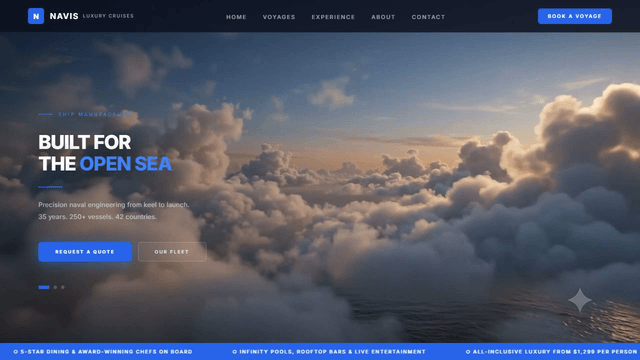</a>

<sub>Recorded from the live site. Every frame of the camera move comes from your scroll position, not a video. Click it to open the demo.</sub>

</div>

**Try these on the live site:**

| | |
|---|---|
| 🖱️ **Scroll slowly** through the hero: the camera flies from the clouds to the ship to the lobby | 🔁 **Scroll back up**: the sequence plays in reverse |
| 🃏 **Hover the experience cards**: the card widens and tilts toward your pointer | ⬅️➡️ **Arrows** under the cards step through them |
| 🖼️ **Hover any gallery photo** to see its caption | 🛳️ **Move over the fleet card** in "The Ocean Is Your World." to tilt it |
| 📱 **On a phone**, tap a card to open it | 🧭 **Nav links** jump to each section |

---

## 📸 Screenshots

All taken from the live deployment at 1440 × 900.

<table>
  <tr>
    <td width="50%">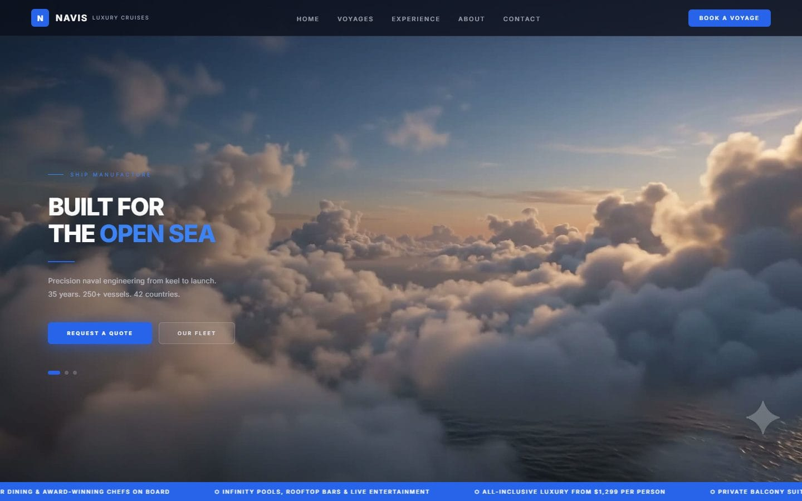<br><sub><b>Hero</b>: frame 1, intro copy over the clouds</sub></td>
    <td width="50%">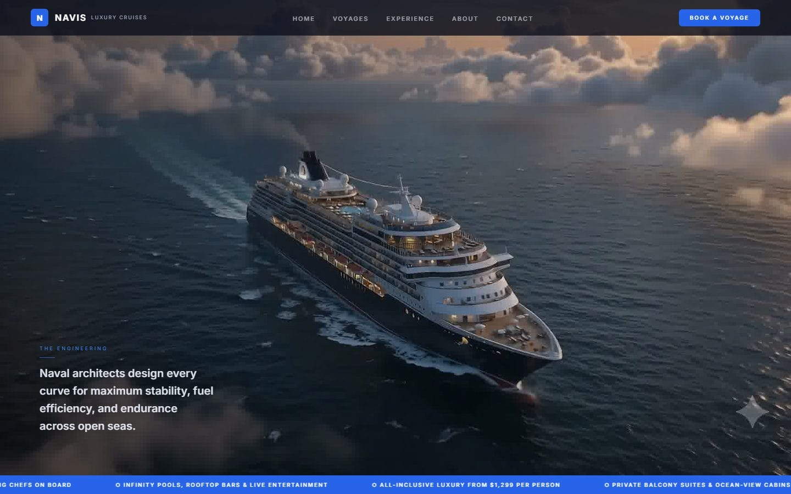<br><sub><b>Hero, mid-scroll</b>: "The Engineering" caption</sub></td>
  </tr>
  <tr>
    <td>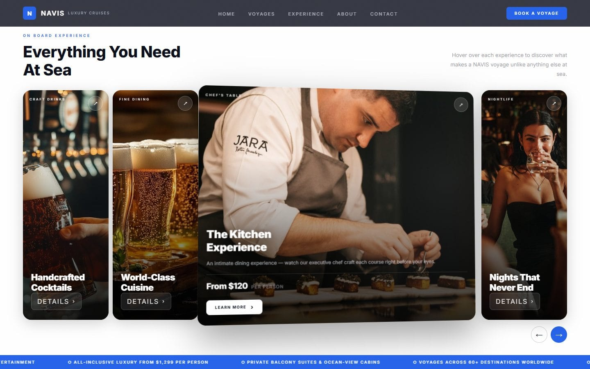<br><sub><b>Everything You Need At Sea</b>: hover widens and tilts a card</sub></td>
    <td>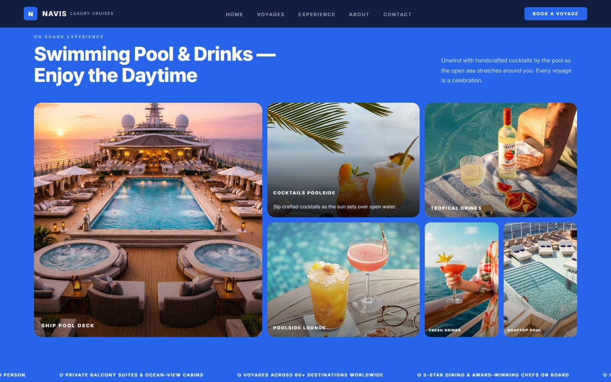<br><sub><b>Swimming Pool &amp; Drinks</b>: hover reveals the caption</sub></td>
  </tr>
  <tr>
    <td>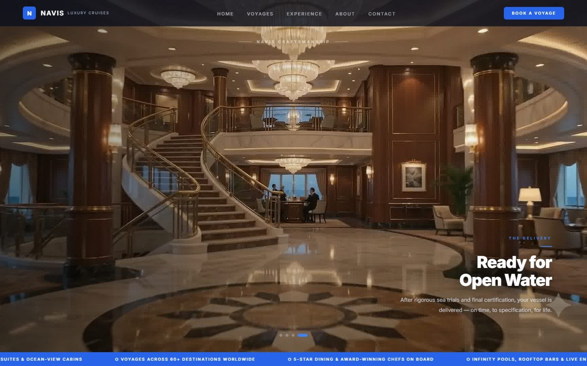<br><sub><b>NAVIS Craftsmanship</b>: second scroll sequence</sub></td>
    <td>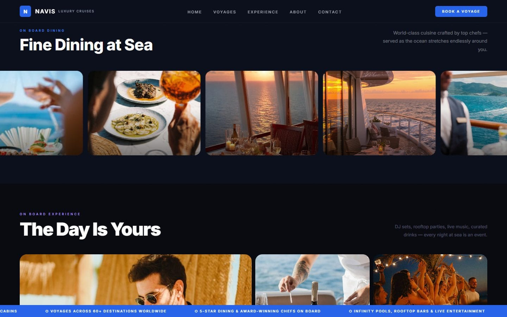<br><sub><b>Fine Dining at Sea</b>: looping photo strip</sub></td>
  </tr>
  <tr>
    <td>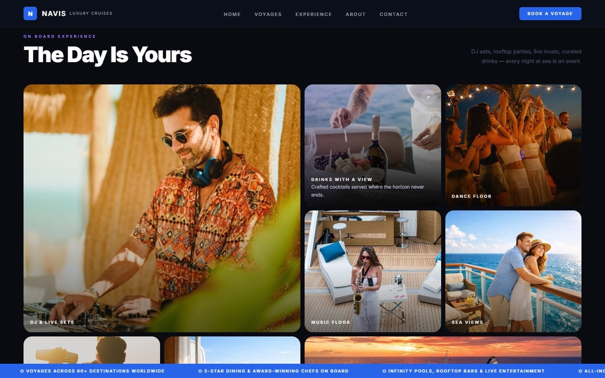<br><sub><b>The Day Is Yours</b>: nightlife bento</sub></td>
    <td>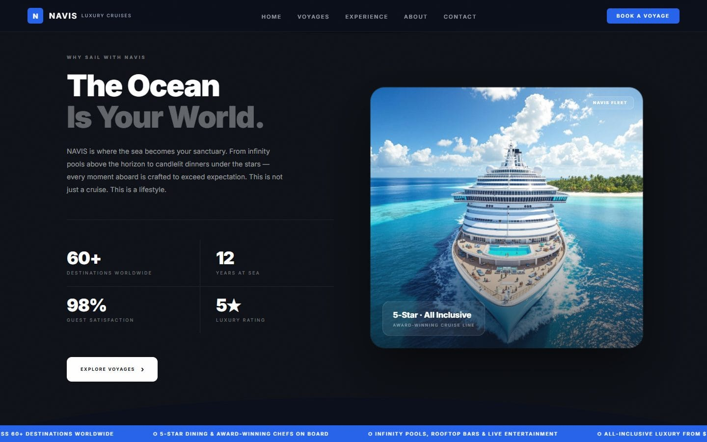<br><sub><b>The Ocean Is Your World.</b>: stats and a 3D tilt card</sub></td>
  </tr>
  <tr>
    <td>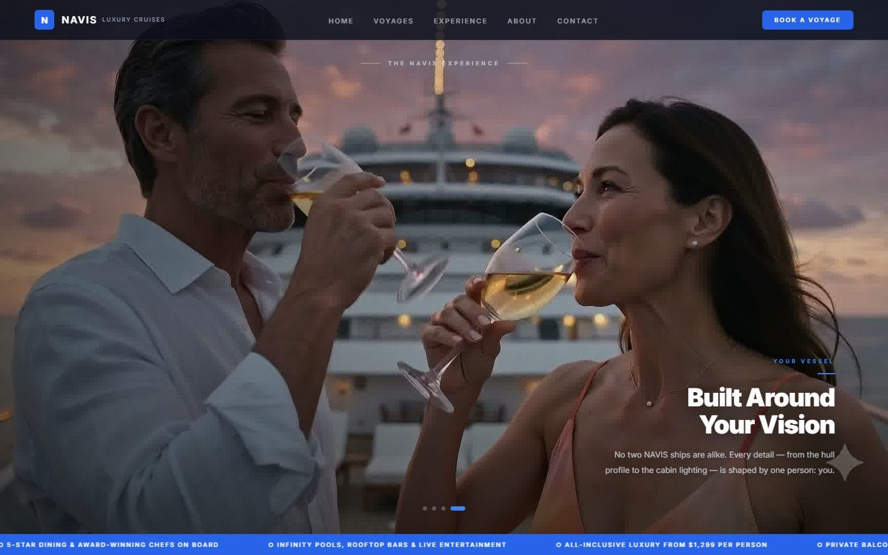<br><sub><b>The NAVIS Experience</b>: third scroll sequence</sub></td>
    <td>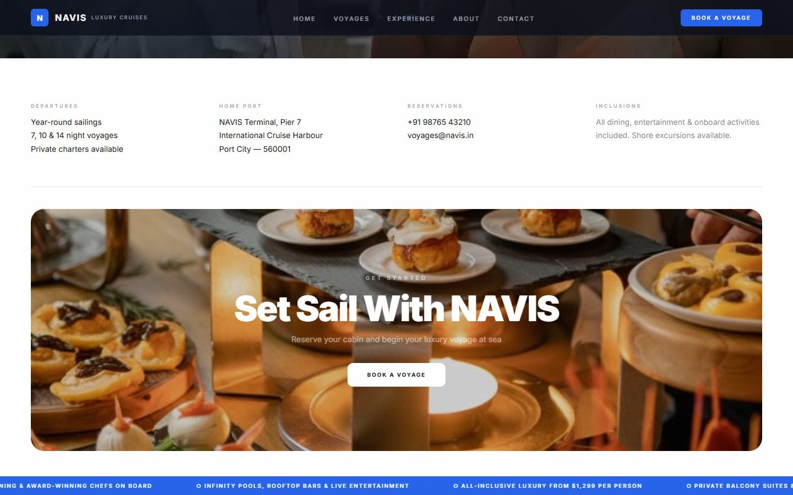<br><sub><b>Set Sail With NAVIS</b>: info and booking card</sub></td>
  </tr>
</table>

### 📱 On phones (390 px)

<table>
  <tr>
    <td>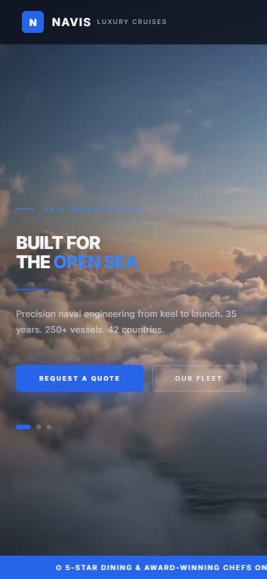</td>
    <td>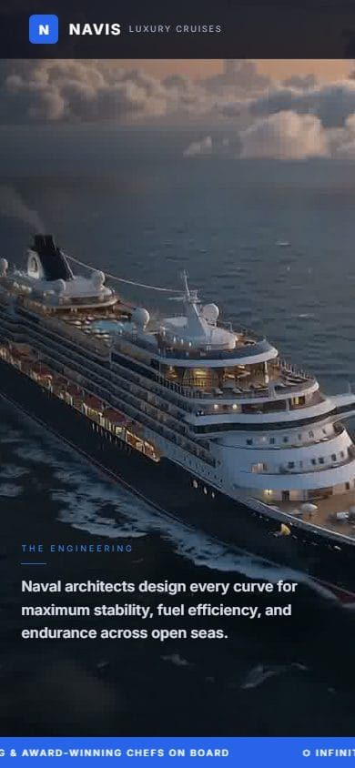</td>
    <td>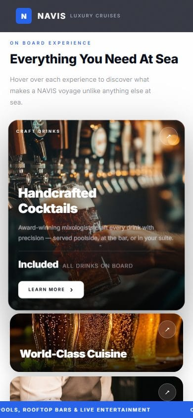</td>
    <td>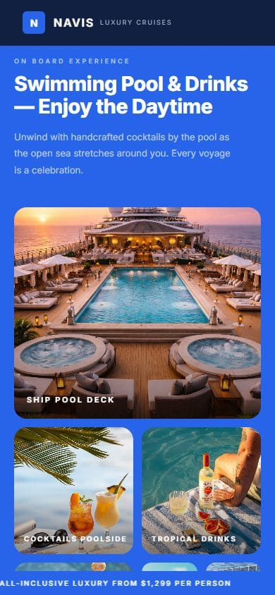</td>
  </tr>
  <tr>
    <td>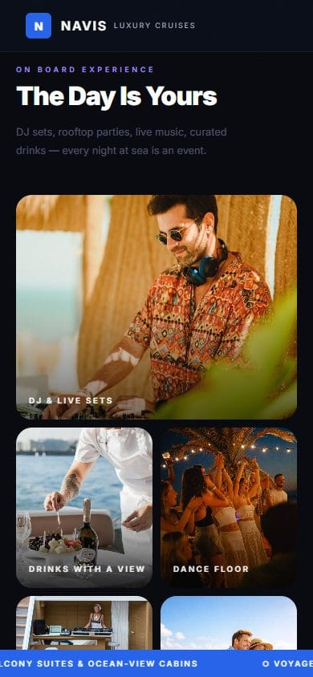</td>
    <td>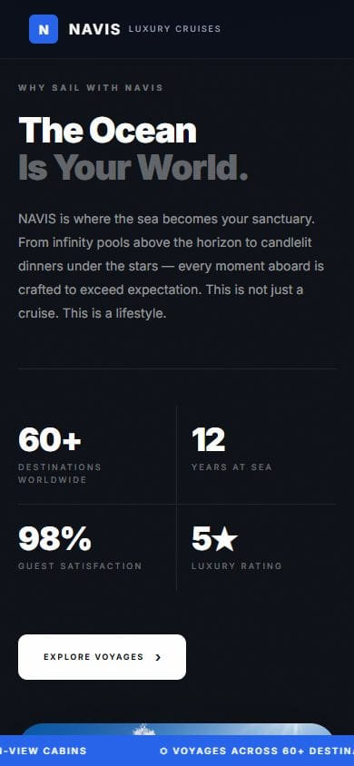</td>
    <td>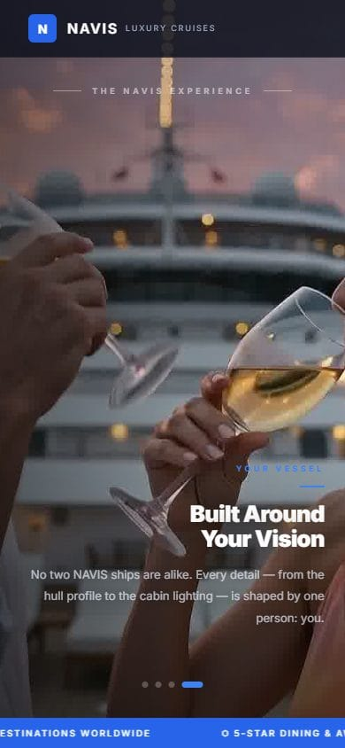</td>
    <td>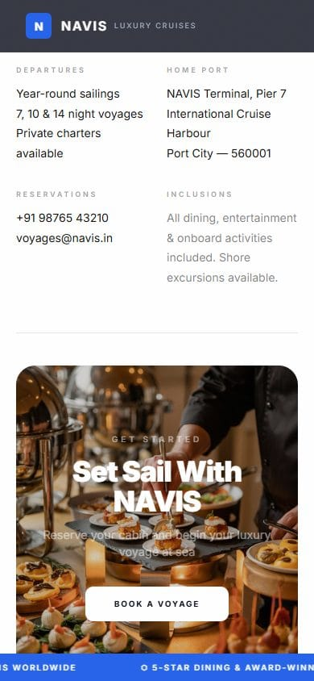</td>
  </tr>
</table>

---

## 🛠️ How it works


- **Scroll is the playhead.** Each 3D section is a 500vh-tall block with a sticky full-screen canvas inside. GSAP ScrollTrigger turns scroll progress into a frame number (0–299), and that frame is drawn "cover"-fit onto the canvas.
- **Three sequences, 600 frames.** The hero and the craftsmanship chapter play the same 300 hero frames from one shared image cache. The voyage chapter plays another 300.
- **Captions follow frame ranges.** For example, frames 130–180 show "The Engineering". Chapter dots track the current scene.
- **No blank canvas while loading.** Frames preload in the background, and until a frame arrives the nearest earlier loaded frame is shown.
- **3D tilt with CSS.** Cards use `perspective`, `rotateX/rotateY` from the pointer position, and a radial "shine" that follows the cursor.

Full details are in **[HOW-IT-WORKS.md](HOW-IT-WORKS.md)**.

## 💬 How it was built

Rebuilt with Claude Code from a handful of prompts, starting with:

```text
/clone-website https://github.com/alagappan567/cafe-3d-scroll
```

**[HOW-IT-WAS-BUILT.md](HOW-IT-WAS-BUILT.md)** lists every prompt word for word, with what each one did: reading the reference, porting it, testing at desktop and phone width, and deploying.

This repo holds the showcase only: screenshots, recordings and write-ups. The site's source code isn't included.

## 🙏 Credits

- Design, copy, photos and frame sequences come from **[alagappan567/cafe-3d-scroll](https://github.com/alagappan567/cafe-3d-scroll)**. This is an independent rebuild of that repo's page.
- Built with [Claude Code](https://claude.com/claude-code).

> **Concept site.** NAVIS is a fictional cruise line. "Book a Voyage" and the contact details are placeholders: nothing is booked or sold.
